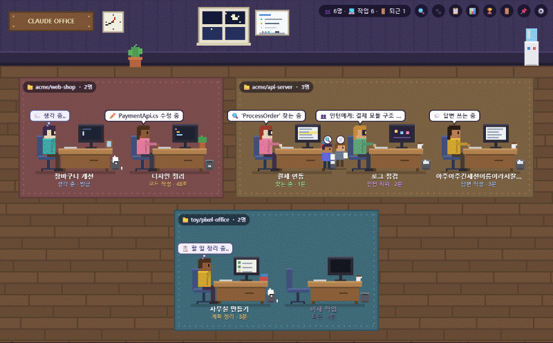
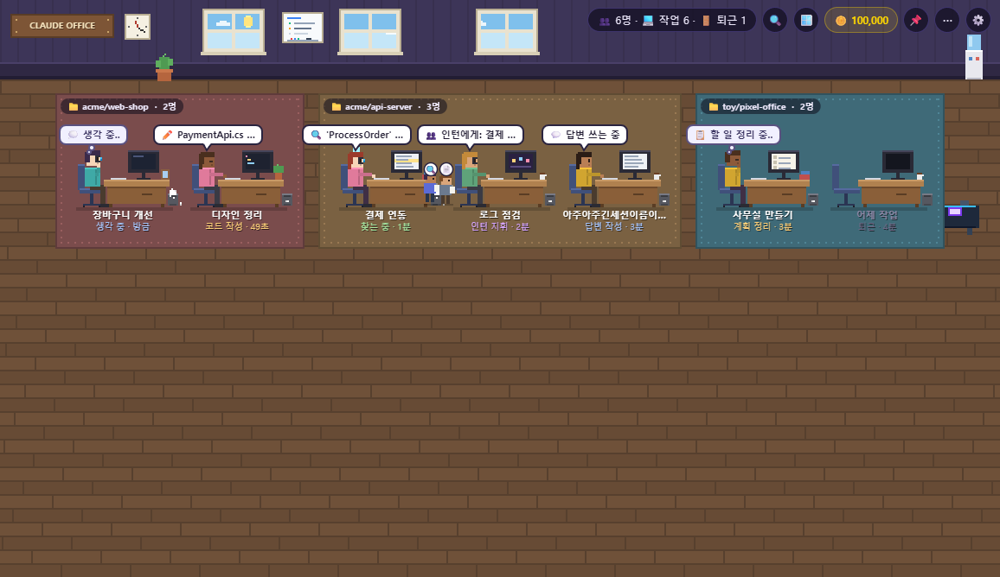
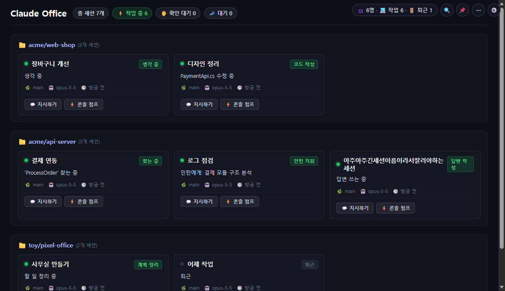
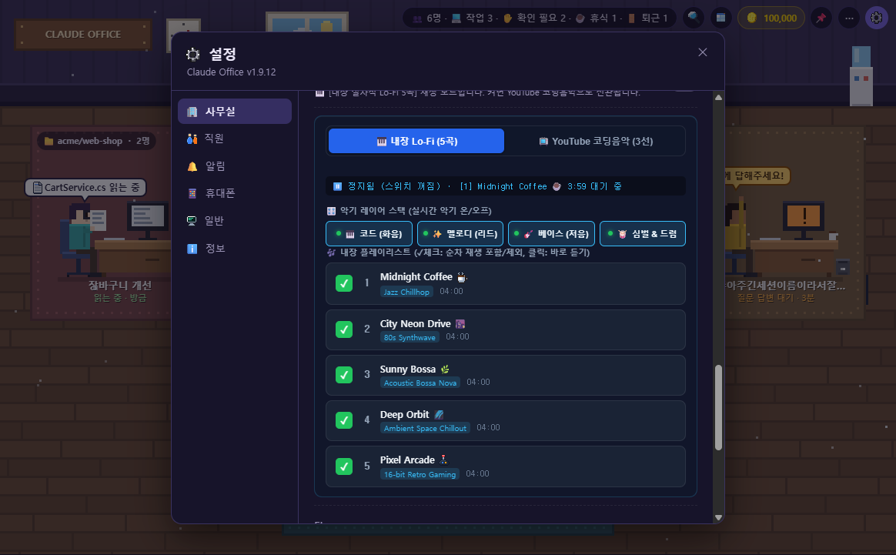
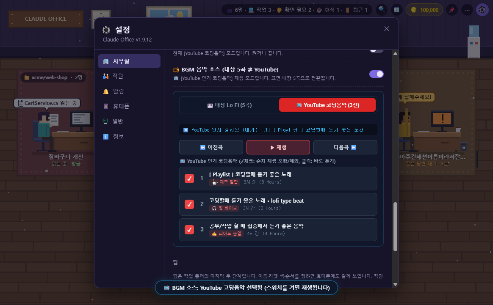
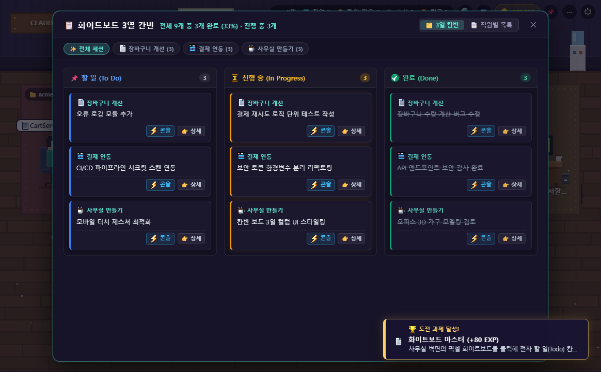
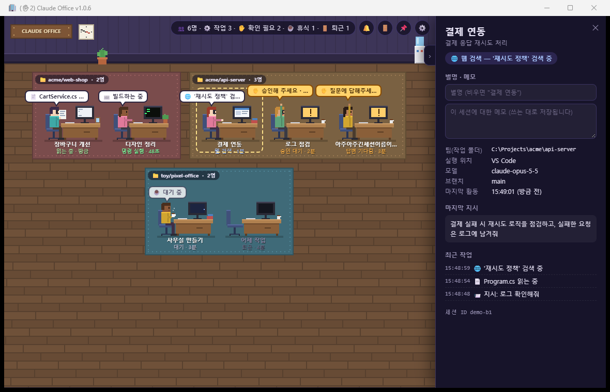
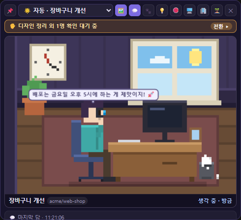
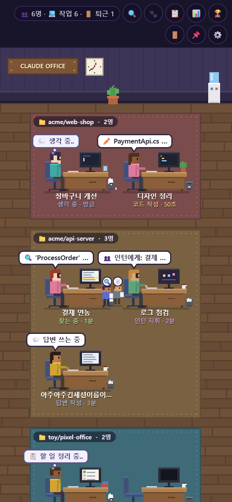
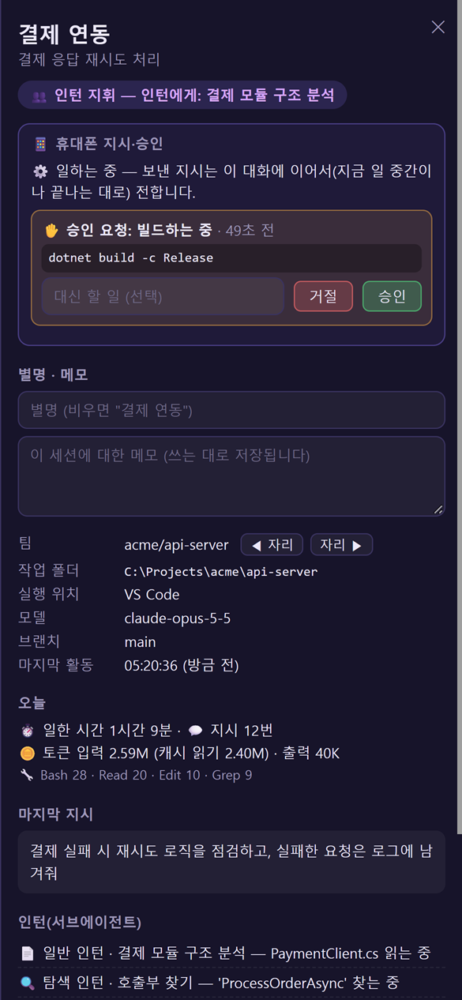

<div align="center">


# 🧑‍💻 Claude Pixel Office

[한국어](README.md) · **English**

[](https://github.com/jibong614/claude-pixel-office/releases)
[](https://github.com/jibong614/claude-pixel-office)
[](https://dotnet.microsoft.com/download/dotnet/8.0)
[](tests/ClaudeOffice.Tests)
[](LICENSE)

**See at a glance what Claude Code is doing and whether it's waiting for your approval — as a retro pixel-art office on Windows.**  
*Features procedural Lo-Fi turntable & popular YouTube coding music, cozy cat adoption, desktop MiniWidget, and mobile remote control.*

[🚀 Quick Start](#-quick-start) · [✨ Key Features](#-key-features) · [📸 Screenshots](#-screenshots) · [🎮 Controls](#-shortcuts--controls) · [📱 Mobile Remote Control](#-mobile-remote-control-optional) · [📖 FAQ](#-frequently-asked-questions-faq)

<br/>



🎮 **Try it in the browser first (no installation needed)**: **[https://jibong614.github.io/claude-pixel-office/?demo&lang=en](https://jibong614.github.io/claude-pixel-office/?demo&lang=en)**

</div>

> [!NOTE]
> This is an unofficial, community-driven open-source tool not affiliated with Anthropic. It safely and read-only parses local conversation logs recorded by Claude Code on your PC.  
> To switch language in the app: Tray right-click ⚙️ **Settings → 🏢 Office → Language → English**.

---

## 📸 Screenshots

### 💻 Main Screens
| 🧑‍💻 Pixel Office Mode | 💼 Business Dashboard Mode (`Shortcut O`) |
| :---: | :---: |
|  |  |
| *Pixel art agents, desks, subagent interns, autonomous idle behaviors* | *Clean, dot-free card grid with a unified dark tone (`#0d0f17`)* |

### 🎵 Cozy Coding BGM Player (Built-in 5 Tracks ⇄ YouTube Top 3)
| 🎹 Built-in Lo-Fi 5 Tracks & 4 Stem Live Mixer | 📺 YouTube Coding Music 3-Mix & Vertical Checklist |
| :---: | :---: |
|  |  |
| *5 distinct 4-minute tracks (Jazz Lo-Fi, Synthwave, Bossa Nova, Ambient, 16-Bit Arcade) + 4-stem live instrument toggles* | *Curated top 3 coding music streams + `✓` checkbox loop toggle + floating mini player* |

### 🛋️ Office Life & Kanban
| 🛋️ Furniture Decor & 3-Stage Cat Adoption Shop | 📋 Live 3-Column Kanban Board (Auto-extracted) |
| :---: | :---: |
|  |  |
| *11 Rich Themes (Sakura, Forest, Sunset Ocean, etc.), free starter turntable, kitten ➔ adult cat & 10 female hairstyles* | *Automatically parses session transcripts into live To Do / In Progress / Done cards* |

### 🏆 Quests & Details
| 🏆 30 Challenge Badges & Title Book | 🔍 Agent Detail Drawer Panel (Tokens & Cost Stats) |
| :---: | :---: |
|  |  |
| *Earn coin rewards and developer EXP titles by completing milestones* | *Active tool, recent actions, today's tokens, and cache cost savings* |

### 🪟 Desktop MiniWidget
| 🪟 Desktop MiniWidget (3-Tier Responsive) | 🏝️ Ultra-Slim Dynamic Island (MiniBar) |
| :---: | :---: |
|  |  |
| *Desktop MiniWidget with loafing/cursor-swiping 🐱 Companion Cat + 3-tier scaling* | *Walk Mode with companion cat following & minime crouching to gently pet (hearts)* |

### 📱 Mobile Remote Monitoring & Approvals
| 📱 Real-Time Mobile Office | 🔍 Pre-Approval Git Diff Review |
| :---: | :---: |
|  |  |
| *No app install needed; scan QR code once to monitor over LTE/5G* | *Review code diffs before approving, 🎙️ voice instructions, 🛑 stop* |

---

## ✨ Key Features

### 1. 🧑‍💻 Intuitive Multi-Session Visualization & Business Mode
- **Session = Agent, Folder = Team Area (Rug), Subagent = Intern**: Keep track of multiple terminal sessions at a glance without switching windows.
- **Real-Time Action Speech Bubbles**: Shows reading (`Read`), searching (`Grep/Glob`), writing code (`Edit/Write`), running commands (`Bash/PowerShell`), and web queries in clear speech bubbles.
- **Modern Clean Dashboard (`Shortcut O`)**: Switch between the retro pixel office and an enterprise-ready card grid view with a unified dark background (`#0d0f17`).

### 2. 🎵 Cozy Coding BGM Player (Built-in 5 Tracks ⇄ YouTube Coding Music)
- **5 Distinct Genres & 4-Minute Multi-Stage Narrative Progressions**:
  - `[ 1 ] Midnight Coffee ☕` (72 BPM / 04:00): Jazz Lo-Fi (Rhodes chords + vibrato lead + upright bass + vinyl crackle & swing boom-bap drums)
  - `[ 2 ] City Neon Drive 🌆` (116 BPM / 04:00): 80s Synthwave (Sawtooth brass + 16th rolling bass + 4-on-the-floor kick & gated snare)
  - `[ 3 ] Sunny Bossa 🌿` (122 BPM / 04:01): Acoustic Bossa Nova (Nylon guitar strum + marimba/flute + walking bass + wooden rimshot & maracas)
  - `[ 4 ] Deep Orbit 🌌` (50 BPM / 04:00): Space Ambient (Warm space drone + crystalline interstellar chimes + 40Hz sub pulse & spatial clicks)
  - `[ 5 ] Pixel Arcade 🕹️` (138 BPM / 04:00): 16-Bit Retro Arcade (Chiptune arpeggios + 7.2Hz vibrato hero lead + slap bass)
- **4-Stem Real-Time Stack Mixer**: Independently toggle Chords, Melody, Bass, and Drums on the fly.
- **Curated Top 3 YouTube Coding Music**: Switch smoothly between procedural synth music and live YouTube coding streams with `[ Built-in ⇄ YouTube ]`.
- **Vertical Checklist & Quick Jump**: Check or uncheck songs with `✓` to include or exclude them from sequential playback, or click any track to jump instantly.
- **Floating Mini Player**: Throttling-resistant offscreen/mini playback with a 140px bottom-right pill mode (`−`) and smart audio fallback.

### 3. 🛋️ Office Life, Cat Adoption & Whiteboard Kanban
- **🪙 11 Background Themes & Office Decor Shop**: Transform your office with 11 themes (Cherry Blossom, Forest, Sunset Ocean, Midnight Library, 8-Bit Arcade, Nordic Snow, etc.), free starter LP turntable, beanbags, and arcade cabinets, with instant restoration to the default theme.
- **🎨 10 Female Hairstyles & Custom Look Rolls**: Long straight, wavy curls, hippie perm, half-up, ribbons, twin tails, braids, and C-curls easily swappable via look roll (🎲).
- **🐱 3-Stage Cat Evolution & Monitor Perch**: Adopt a kitten and watch it grow into a mischievous teen and majestic adult cat. Cats hop across desks and nap on top of monitors; petting them triggers purring and cute thought bubbles.
- **📋 Live 3-Column Kanban Board**: Automatically parses session conversations into live To Do / In Progress / Done cards on the office whiteboard.
- **🏆 30 Challenge Badges & Quest Book**: Unlock achievements for coin rewards and level up your developer title and EXP.
- **☕ 24h Day/Night Lighting Cycle**: Dynamically syncs with your PC clock for natural transitions between bright morning, warm sunset, twilight, and focused night spotlights.

### 4. 🪟 Desktop MiniWidget & Dynamic Island
- **Always-on-Top Floating Companion**: Monitor your primary agent in the corner of your screen even when editors or browsers are full-screen.
- **3-Tier Responsive Scaling (Large 360px · Medium 300px · Small 260px)**: Fonts and buttons scale proportionally with an optimized, snappy combo switcher.
- **Ultra-Slim Dynamic Island (MiniBar)**: Floats at the top as a 44px capsule that expands on hover with one-click terminal jump, emergency stop, and widget restore (`🪟` / `💼`) buttons.
- **🐾 Shimeji Wide Walk Mode & 🐱⭐ Companion Cat System**:
  - Agents step away from their desks to freely roam the bottom of your screen with 10 healing motions (waving 👋, thinking 💡, humming 🎵, sipping coffee, sitting down, stretching, jumping) at a calm 13.5px/s pace.
  - **Random Walking & Action Chaining**: Pauses naturally in the middle of your screen for 1.8~4.2s bursts and chains multiple idle actions (35% probability) instead of repetitive wall-to-wall bouncing.
  - **Designate Companion Cat**: Pick any adopted cat in the Shop (`☆ Set Companion` button) or Settings tab to accompany you on top of the MiniWidget monitor and in Walk Mode.
  - **Monitor Top Companion Cat**: Loafs on top of the monitor, lies belly-down gazing into the screen, swipes with its paw following your mouse cursor, grooms, sleeps, and purrs when clicked!
  - **Walk Mode Petting Interaction (`pet_cat`)**: Minime occasionally pauses, crouches down, and **gently pets the purring cat** with happy squinting eyes, rosy blushing cheeks, and floating hearts (`💕`). Clicking on the walking cat also immediately triggers petting!
  - **Toolbar Headroom Optimization**: Window headroom expanded by +25px and toolbar refined into a sleek 28px pill capsule, ensuring the toolbar never obstructs minime's head.
- **💡 25 Developer Memes Easter Egg**: Click to trigger humorous developer quotes wrapped into 2-line thought bubbles.

### 5. 📱 Mobile Remote Control — Keep Work Moving While Away
- **Zero-Setup Quick Connect**: Scan a QR code on your PC to immediately open the dashboard on your phone's browser (no login required).
- **📱 Mobile Screen Rotation Optimization**: Auto-adapts viewport seamlessly when rotating between portrait and landscape modes without shrinking or UI distortion.
- **🔍 Pre-Approval Git Diff Review**: When Claude requests permission to modify files, expand the unified diff (`+N`, `-N`) on your phone to inspect changes before tapping **[Approve]**.
- **🎙️ Voice-to-Prompt Instructions**: Tap the microphone on mobile to dictate instructions; speech is transcribed in real-time and delivered to Claude.
- **Seamless Context Resumption**: Send a follow-up instruction to an idle session, and it wakes up in the exact same conversation context.
- **❓ Multiple-Choice Answers & 🛑 Emergency Stop**: Tap buttons to answer questions directly, or safely halt runaway loops in 0.01 seconds.
- **🔒 End-to-End Encryption (AES-256-GCM)**: Relayed via Google Firebase free tier, but encrypted using a local key in the QR `#hash` that never touches any server.

### 6. ⚙️ Lightweight, Native Windows Performance
- **Standalone Transparent Settings**: Right-click the system tray to open a lightweight 720×640 modal without loading the main dashboard.
- **Zero-Idle CPU Footprint**: Efficient 0.7s delta parsing uses 0% CPU when sessions are idle.
- **52 Passing Automated Unit Tests**: Complete xUnit test suite ensuring rendering, hook dispatch, encryption, virtual wide layout, and window mode switching integrity.

---

## 🚀 Quick Start

### 1. Download & Run (Recommended)
1. Download the latest `ClaudePixelOffice-v*-win-x64.zip` from [Releases](https://github.com/jibong614/claude-pixel-office/releases).
2. Extract the archive and launch `ClaudeOffice.exe`.
3. On first launch, click **[Yes]** when prompted **"Connect to Claude Code?"** (recommended).
4. Start a conversation in Claude Code as usual—an employee appears at a desk!
5. *(Optional)* For mobile view: Tray right-click ⚙️ Settings → 📱 Phone → **[Turn On] → [Show QR]** and scan with your phone.

> [!TIP]
> - **Requirements**: Windows 10/11, [WebView2 Runtime](https://developer.microsoft.com/microsoft-edge/webview2/) (built into Windows 11; no .NET install required).
> - If Windows SmartScreen appears due to unsigned binary: click **More info ➔ Run anyway**.
> - Future releases can be updated with one click from inside the application.

### 2. Build from Source
Requires [.NET 8 SDK](https://dotnet.microsoft.com/download/dotnet/8.0).
```powershell
git clone https://github.com/jibong614/claude-pixel-office.git
cd claude-pixel-office
dotnet build ClaudeOffice.sln -c Release
src\ClaudeOffice\bin\Release\net8.0-windows\ClaudeOffice.exe
```

---

## 🎮 Shortcuts & Controls

| Control | Action |
|:---|:---|
| **Click Employee** | Open detail drawer panel on the right (click again to close) |
| **Double-Click / `Alt+1~9`** | **One-click jump** to the session's IDE or terminal window |
| **`Shortcut O`** | Toggle between Pixel Office and Clean Business Dashboard |
| **`Shortcut B`** | **Broadcast** an instruction to all active sessions simultaneously |
| **`Shortcut N`** | Night Shift monitor & Morning briefing summary report |
| **🪟 Button** | Toggle **Desktop MiniWidget** (switch to Dynamic Island via top-right pill) |
| **🪙 / 🛋️ Button** | View coin balance and open the 7-item Office Decor Shop |
| **📋 Whiteboard** | Real-time session TODO Kanban board extracted from conversations |
| **🏆 Button** | View the 30-quest achievement & badge book |
| **🛑 Button** | Immediately terminate active tool process and trigger **Emergency Stop** |
| **Tray Icon Right-Click** | Open **⚙️ Standalone Settings Window** / Toggle MiniWidget / Exit |

---

## 🔗 Claude Code Connection (Recommended)

Selecting [Yes] to **"Connect to Claude Code?"** registers lightweight event hooks in your local `~/.claude/settings.json`.

```
~/.claude/settings.json
  ├── PermissionRequest ➔ ✋ Real-time approval detection & mobile dispatch
  ├── Notification      ➔ Precise input and notification state tracking
  ├── SessionEnd        ➔ Employee departs (🚪) immediately on session exit
  ├── Stop/SessionStart ➔ Wake up idle sessions with mobile instructions (asyncRewake)
  └── PreToolUse        ➔ 🛑 Block tool execution immediately on emergency stop (exit code 2)
```

- All communication stays within `127.0.0.1` loopback; if the app is closed, hooks exit silently without leaving errors in Claude Code.
- Disconnecting cleanly removes only the added lines (an automated backup is preserved).

---

## 📱 Mobile Remote Control (Optional)

Open tray menu ⚙️ Settings → 📱 Phone → **[Turn On] → [Show QR]** to connect instantly.

- **End-to-End Encryption (E2EE)**: Relayed via Firebase free tier, but summaries are locked with **AES-256-GCM** using a local key in the QR `#hash`, meaning the server and third parties can never read your data.
- **Automatic Away Detection**: When your PC is idle for 30 seconds or the screen is locked (`Win+L`), Away mode turns on automatically so approvals and prompts reach your phone.
- **Full Remote Management**: Review Git diffs, approve or reject tool runs, dictate prompts via voice, and trigger emergency stops from anywhere.
- For technical architecture and details, see **[docs/MOBILE.md](docs/MOBILE.md)**.

---

## 🛠️ Architecture & Tech Stack

```
src/ClaudeOffice/
  ├── Monitoring/     Delta transcript watcher, tool catalog, snapshot builder
  ├── Hooks/          Loopback hook receiver (HookServer), settings.json integration
  ├── Cloud/          Mobile summary encryption & Firebase relay integration
  ├── Remote/         Mobile prompt/approval/emergency stop hub (RemoteHub)
  ├── WidgetWindow.cs Always-on-top transparent MiniWidget & Dynamic Island
  ├── SettingsWindow.cs Tray-exclusive 720×640 standalone transparent settings modal
  ├── MainWindow.xaml Main WebView2 host and tray management
  └── wwwroot/        Pure HTML5 Canvas pixel rendering engine (office.js, office.css)
tests/ClaudeOffice.Tests/ 45 automated unit tests (rendering, hooks, crypto, layout)
```

---

## 📖 Frequently Asked Questions (FAQ)

<details>
<summary><b>Q. I don't see my employee in the office.</b></summary>
Sessions whose last conversation exceeds the display period (default 12 hours) are hidden. Increase the display period to 24 hours, 3 days, or 7 days under Tray ⚙️ Settings → 👥 Employees.
</details>

<details>
<summary><b>Q. Clicking ✕ doesn't quit the application.</b></summary>
By default, closing hides the window to the system tray (🧑‍💻). To exit completely, right-click the tray icon and select <b>Exit</b>.
</details>

<details>
<summary><b>Q. Approvals are slow to appear or missing.</b></summary>
Without the Claude Code connection, the app can only guess approvals from file write delays. Connecting via the 🔕 icon or Settings enables 0.01s real-time detection.
</details>

<details>
<summary><b>Q. Can anyone else see my code through the free server?</b></summary>
No. The server only transmits AES-256-GCM encrypted binary blobs. The decryption key exists exclusively in the QR link's <code>#hash</code> and is never transmitted in HTTP headers or logged by the server.
</details>

---

## 📄 License & Credits

- Licensed under the [MIT License](LICENSE).
- **Official App Icon**: Dedicated pixel-art icon (`src/ClaudeOffice/Assets/office_a.ico`, `src/ClaudeOffice/wwwroot/icons/icon-192.png`) — MIT License
- All pixel art and office graphics are rendered dynamically in code on HTML5 Canvas without external image files.
- QR Code generation: [qrcode-generator](https://github.com/kazuhikoarase/qrcode-generator) 1.4.4 (MIT License).
- "Claude" is a trademark of Anthropic. This project is not affiliated with Anthropic.
