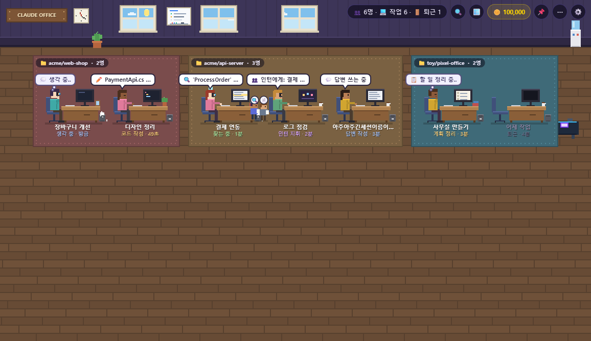
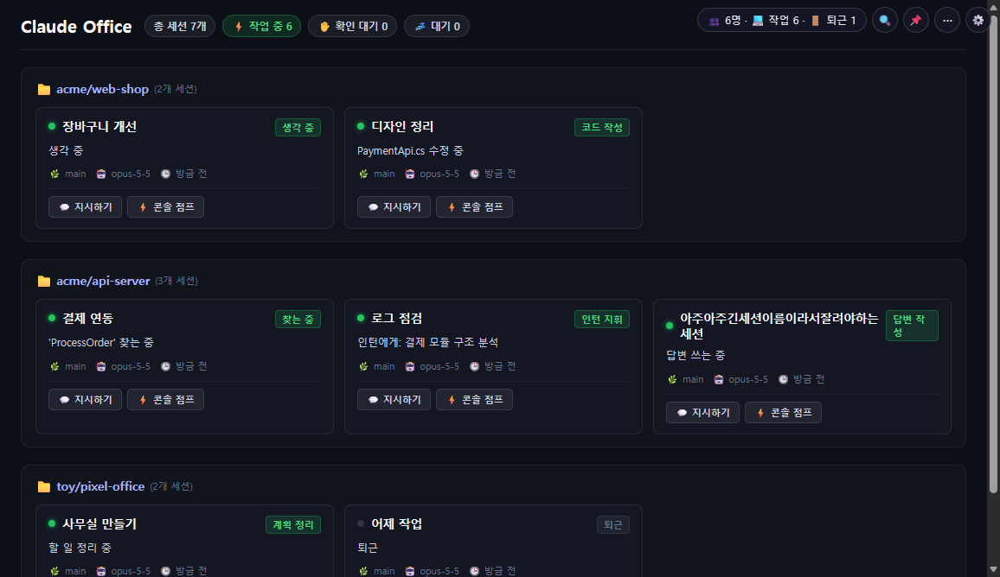
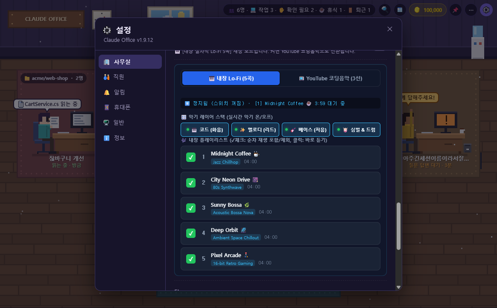
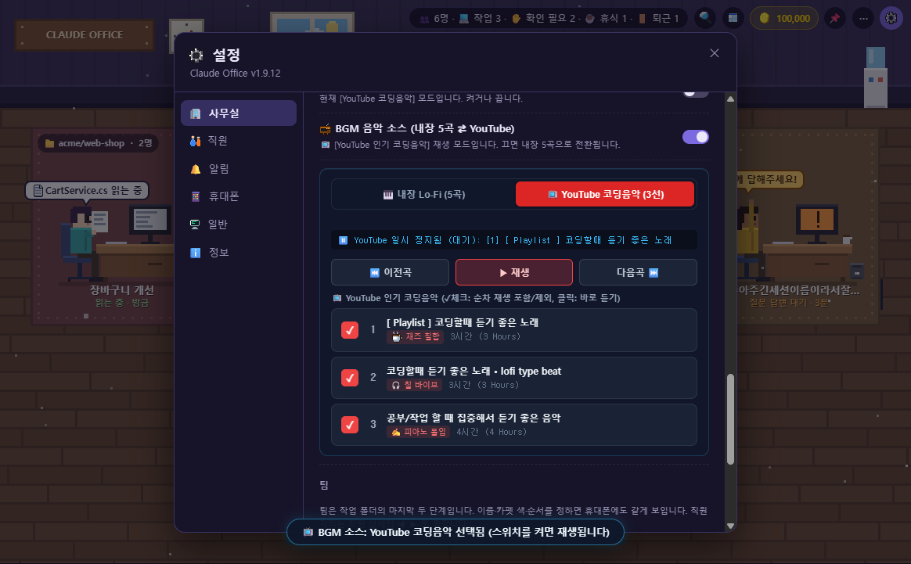
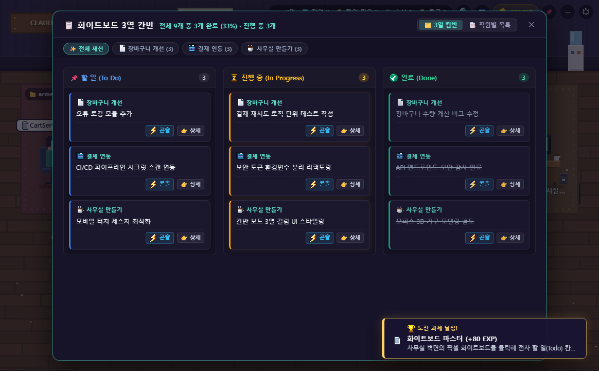
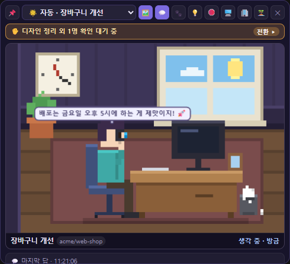
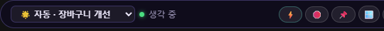

<div align="center">


# 🧑‍💻 Claude Pixel Office

**한국어** · [English](README.en.md)

[](https://github.com/jibong614/claude-pixel-office/releases)
[](https://github.com/jibong614/claude-pixel-office)
[](https://dotnet.microsoft.com/download/dotnet/8.0)
[](tests/ClaudeOffice.Tests)
[](LICENSE)

**Claude Code가 지금 무엇을 하는지, 내 승인을 기다리는지 — 레트로 픽셀 사무실로 한눈에 모니터링하는 Windows 데스크탑 동반자입니다.**  
*턴테이블 절차적 Lo-Fi & YouTube 인기 코딩음악, 귀여운 고양이 키우기, 바탕화면 미니위젯, 모바일 원격 제어까지 지원합니다.*

[🚀 빠른 시작](#-빠른-시작) · [✨ 주요 기능](#-주요-기능) · [📸 스크린샷](#-스크린샷) · [🎮 조작법](#-단축키-및-화면-조작) · [📱 휴대폰 원격 제어](#-휴대폰-원격-제어-선택) · [📖 FAQ](#-자주-묻는-질문-faq)

<br/>


🎮 **설치 없이 브라우저로 미리 보기**: **[https://jibong614.github.io/claude-pixel-office/?demo](https://jibong614.github.io/claude-pixel-office/?demo)**

</div>

> [!NOTE]
> 본 프로그램은 Anthropic과 공식적인 제휴가 없는 커뮤니티 오픈소스 도구입니다. Claude Code가 로컬에 기록하는 세션 대화 로그를 읽기 전용으로 안전하게 파싱합니다.

---

## 📸 스크린샷

### 💻 메인 화면
| 🧑‍💻 픽셀 오피스 모드 | 💼 비즈니스 대시보드 모드 (`단축키 O`) |
| :---: | :---: |
|  |  |
| *세션별 픽셀 캐릭터, 책상, 인턴, 자율 행동 시각화* | *도트 없는 단일 다크톤(`#0d0f17`) 카드 그리드 전문 업무 뷰* |

### 🎵 힐링 코딩 BGM 플레이어 (내장 5곡 ⇄ YouTube 3선)
| 🎹 내장 Lo-Fi 5곡 & 4대 악기 실시간 스택 믹서 | 📺 YouTube 인기 코딩음악 3선 & 수직 체크리스트 |
| :---: | :---: |
|  |  |
| *재즈 칠합·신스웨이브·보사노바·앰비언트·16비트 아케이드 4분 명곡 5선 + 4대 악기 실시간 온오프* | *유명 코딩음악 3선 연동 + ✓ 체크를 통한 순차 재생 포함/제외 + 플로팅 미니 플레이어* |

### 🛋️ 오피스 라이프 & 칸반
| 🛋️ 가구 & 고양이 3단계 입양 상점 | 📋 실시간 3열 칸반 보드 (대화 자동 추출) |
| :---: | :---: |
|  |  |
| *코인 수집으로 턴테이블·빈백 배치, 🐱 아깽이➔캣초딩➔성묘 3단계 성장 & 모니터 착석* | *Claude 세션 대화에서 자동으로 추출되는 To Do / In Progress / Done 실시간 칸반 카드* |

### 🏆 도전 과제 & 디테일
| 🏆 30종 도전 과제 도감 (EXP & 칭호 획득) | 🔍 직원 상세 서랍 패널 (토큰 & 비용 통계) |
| :---: | :---: |
|  |  |
| *미션 달성 시 코인 보상 및 레벨업 칭호 획득* | *진행 중인 도구, 최근 히스토리, 오늘 토큰/절감 비용 통계* |

### 🪟 바탕화면 미니위젯 (MiniWidget)
| 🪟 바탕화면 미니위젯 (3단계 반응형) | 🏝️ 초슬림 다이내믹 아일랜드 (미니바) |
| :---: | :---: |
|  |  |
| *크게/보통/작게 3단계 반응형 폰트 축소 + 개발자 유머 말풍선* | *상단 44px 플로팅 알약 캡슐, 호버 시 점프/중단/복귀 컨트롤* |

### 📱 휴대폰 원격 모니터링 & 승인
| 📱 모바일 실시간 사무실 | 🔍 승인 전 Git Diff 사전 검토 |
| :---: | :---: |
|  |  |
| *앱 설치 없이 QR 한 번으로 LTE/5G 어디서나 모니터링* | *수정될 코드 diff 확인 후 승인, 🎙️ 음성 지시, 🛑 긴급 중단* |

---

## ✨ 주요 기능

### 1. 🧑‍💻 직관적인 다중 세션 시각화 & 비즈니스 모드
- **세션 = 직원, 폴더 = 팀 구역(카펫), 서브에이전트 = 인턴**: 여러 터미널을 번갈아 확인하지 않아도 누가 어떤 작업을 하는지 즉시 파악할 수 있습니다.
- **실시간 작업 상태 말풍선**: 읽기(`Read`), 검색(`Grep/Glob`), 코드 작성(`Edit/Write`), 명령 실행(`Bash/PowerShell`), 웹 탐색 등 실제 동작을 친근한 한글 말풍선으로 표현합니다.
- **모던 클린 대시보드 (`단축키 O`)**: 픽셀 그래픽 대신 카드 그리드로 대화 상태와 터미널 점프를 한눈에 관리하는 비즈니스 모드(단일 다크톤 `#0d0f17`)를 지원합니다.

### 2. 🎵 힐링 코딩 BGM 플레이어 (내장 5곡 ⇄ YouTube 코딩음악)
- **5개 장르 극적 분리 & 4분 다단계 서사 전개**:
  - `[ 1 ] Midnight Coffee ☕` (72 BPM / 04:00): 재즈 칠합 (로즈 건반 + 비브라토 리드 + 더블베이스 + 바이닐 크랙클 & 스윙 붐뱁 드럼)
  - `[ 2 ] City Neon Drive 🌆` (116 BPM / 04:00): 80s 신스웨이브 (쏘우투스 브라스 + 16분 롤링 베이스 + 4-on-the-floor 킥 & 게이티드 스네어)
  - `[ 3 ] Sunny Bossa 🌿` (122 BPM / 04:01): 어쿠스틱 보사노바 (나일론 기타 스트럼 + 마림바/플루트 + 워킹 베이스 + 우든 림샷 & 마라카스)
  - `[ 4 ] Deep Orbit 🌌` (50 BPM / 04:00): 스페이스 앰비언트 (웜 스페이스 드론 + 크리스털 성간 차임 + 40Hz 서브 펄스 & 공간감 클릭)
  - `[ 5 ] Pixel Arcade 🕹️` (138 BPM / 04:00): 16비트 레트로 오락기 (칩튠 아르페지오 + 7.2Hz 비브라토 영웅 리드 + 슬랩 베이스)
- **4대 악기 실시간 스택 믹서**: 코드(화음), 멜로디(리드), 베이스(저음), 드럼(비트) 악기별 실시간 온/오프 토글.
- **YouTube 인기 코딩음악 3선 연동**: 검증된 3~4시간 인기 코딩 BGM 플레이어 연동 및 `[ 내장 ⇄ YouTube ]` 원클릭 소스 전환.
- **수직 플레이리스트 & `✓` 체크 제어**: 곡별 `✓` 체크 버튼으로 다음 곡 순차 재생 포함/제외 제어 및 즉시 점프 지원.
- **플로팅 미니 플레이어**: 브라우저 차단 없는 안정적 재생, 우측 하단 140px 알약 축소(`−`) 지원 및 스마트 자동 폴백.

### 3. 🛋️ 오피스 라이프, 고양이 육성 & 화이트보드 칸반
- **🪙 코인 & 인테리어 상점**: 태스크 완료와 토큰 절약으로 코인을 모아 LP 턴테이블, 마약 빈백, 아케이드 캐비닛 등 7종 소품을 구매하고 배치합니다.
- **🐱 고양이 3단계 성장 & 모니터 착석**: 아깽이 ➔ 캣초딩 ➔ 성묘로 성장하며, 책상과 모니터 위를 자유롭게 오가고 쓰다듬을 때 골골송과 함께 애정 어린 말풍선을 띄웁니다.
- **📋 실시간 3열 칸반 보드**: Claude Code 세션 대화에서 할 일(TODO)을 자동 추출하여 To Do / In Progress / Done 카드로 실시간 정리합니다.
- **🏆 30종 도전 과제 & 업적 도감**: 코인 보상 및 EXP 획득을 통한 개발자 레벨업 시스템.
- **☕ 24시간 실시간 조명**: PC 시각과 동기화되어 낮/노을/야간/심야 스포트라이트 조명이 자연스럽게 전환됩니다.

### 4. 🪟 바탕화면 미니위젯 & 다이내믹 아일랜드
- **항상 위에 떠 있는 미니위젯**: IDE나 브라우저를 전체화면으로 사용해도 화면 구석에서 대표 직원의 상태를 살필 수 있습니다.
- **3단계 반응형 크기 조절 (크게 360px · 보통 300px · 작게 260px)**: 위젯 폭을 줄여도 폰트와 조작 버튼이 알맞게 축소되어 여백과 가독성을 보장합니다.
- **초슬림 다이내믹 아일랜드 (미니바)**: 화면 상단에 44px 알약 캡슐 형태로 떠 있어 시야를 가리지 않으며, 마우스 호버 시 콘솔 점프, 비상정지, 위젯 복귀(`🪟` / `💼`) 버튼이 펼쳐집니다.
- **🐾 시메지(Shimeji) 와이드 산책 모드**: 직원이 책상을 벗어나 화면 밑단 광활한 공간을 자유롭게 활보합니다 (커피 들고 걷기, 바닥에 앉아 쉬기 등 10대 모션).
- **💡 25종 개발자 밈 이스터에그**: 위젯 클릭 시 캐릭터 머리 위 생각 말풍선에 재치 있는 개발 유머가 팝업됩니다.

### 5. 📱 휴대폰 원격 제어 — 외출 중에도 안전한 개발 지속
- **무설치 간편 연결**: PC에서 QR 코드 한 번만 스캔하면 모바일 브라우저로 즉시 연결됩니다 (로그인 불필요).
- **🔍 승인 전 Git Diff 사전 검토**: 파일 수정 도구 요청 시, 변경될 코드 diff(`+N`, `-N`)를 모바일 아코디언으로 직접 확인하고 안전하게 [승인]할 수 있습니다.
- **🎙️ 음성 프롬프트 지시 (Voice-to-Prompt)**: 이동 중 마이크 버튼을 누르고 말하면 실시간 텍스트로 자동 변환되어 Claude에게 전달됩니다.
- **연속 대화 이어가기**: 일이 끝난 직원에게 모바일로 새 지시를 보내면 쉬던 세션이 깨어나 같은 맥락에서 이어서 작업합니다.
- **❓ 객관식 질문 원터치 답변 & 🛑 긴급 작업 중단**: 질문 선택지를 터치해 바로 답하고, 무한 루프 발생 시 0.01초 만에 안전하게 작업을 멈출 수 있습니다.
- **🔒 종단간 암호화 (AES-256-GCM)**: 무료 중계 서버를 거치지만 브라우저 로컬 키로 암호화되므로 서버나 제3자가 내용을 절대 열람할 수 없습니다.

### 6. ⚙️ 가볍고 견고한 네이티브 Windows 앱
- **트레이 단독 투명 설정창**: 작업표시줄 트레이 메뉴 우클릭 시 메인 대시보드 로딩 없이 720×640 단독 투명 모달만 가볍게 팝업됩니다.
- **초경량 백그라운드 상주**: 0.7초 차분(Delta) 파일 파싱으로 유휴 시 CPU 점유율 0% 유지.
- **45개 자동화 단위 테스트 전원 통과**: xUnit 테스트 스위트로 렌더링, 훅, 암호화, 위젯 배치, 가상 와이드 너비, 모드 전환 무결성을 철저히 보증합니다.

---

## 🚀 빠른 시작

### 1. 다운로드하여 바로 실행 (권장)
1. [Releases](https://github.com/jibong614/claude-pixel-office/releases)에서 최신 `ClaudePixelOffice-v*-win-x64.zip`을 다운로드합니다.
2. 압축을 풀고 `ClaudeOffice.exe`를 실행합니다.
3. 첫 실행 시 **"Claude Code와 연결할까요?"** 팝업에서 **[예]**를 누릅니다 (권장).
4. 평소처럼 터미널에서 Claude Code로 대화를 시작하면 사무실 책상에 직원이 나타납니다!
5. *(선택)* 휴대폰으로 보려면: 트레이 우클릭 ⚙️ 설정 → 📱 휴대폰 → **[켜기] → [QR 보기]** 스캔.

> [!TIP]
> - **요구사항**: Windows 10/11, [WebView2 런타임](https://developer.microsoft.com/microsoft-edge/webview2/) (Windows 11은 기본 내장, .NET 별도 설치 불필요).
> - 미서명 바이너리로 인해 Windows SmartScreen 경고가 뜰 경우 **추가 정보 ➔ 실행**을 클릭하세요.
> - 새 버전 출시 시 앱 내에서 원클릭으로 간편하게 자동 업데이트됩니다.

### 2. 소스 코드에서 빌드
[.NET 8 SDK](https://dotnet.microsoft.com/download/dotnet/8.0)가 필요합니다.
```powershell
git clone https://github.com/jibong614/claude-pixel-office.git
cd claude-pixel-office
dotnet build ClaudeOffice.sln -c Release
src\ClaudeOffice\bin\Release\net8.0-windows\ClaudeOffice.exe
```

---

## 🎮 단축키 및 화면 조작

| 조작 | 기능 |
|:---|:---|
| **직원 클릭** | 오른쪽 상세 서랍 패널 열기 (다시 누르면 닫힘) |
| **직원 더블클릭 / `Alt+1~9`** | 해당 세션의 콘솔(VS Code, Cursor, 터미널)로 **원클릭 점프** |
| **`단축키 O`** | 픽셀 오피스 ↔ 모던 클린 비즈니스 대시보드 모드 전환 |
| **`단축키 B`** | 모든 세션에 일괄 지시를 보내는 **전체 브로드캐스트** |
| **`단축키 N`** | 야간 당직(Night Shift) 모니터링 & 아침 업무 브리핑 리포트 |
| **🪟 버튼** | **바탕화면 미니위젯** 켜기/끄기 (우측 상단 캡슐로 아일랜드 전환) |
| **🪙 / 🛋️ 버튼** | 코인 잔액 확인 및 7종 인테리어 가구 상점 열기 |
| **📋 화이트보드** | 세션 대화에서 자동 추출된 실시간 할 일(TODO) 칸반 보드 열기 |
| **🏆 버튼** | 30종 도전 과제(업적) 도감 확인 |
| **🛑 버튼** | 실행 중인 도구 프로세스 즉각 종료 및 **긴급 작업 중단** |
| **트레이 아이콘 우클릭** | **⚙️ 단독 투명 설정창 열기** / 🪟 미니위젯 켜기 / 끝내기 |

---

## 🔗 Claude Code 연결 안내 (권장)

처음 실행 시 **"Claude Code와 연결할까요?"**에 [예]를 선택하면, 로컬 `~/.claude/settings.json`에 안전한 이벤트 훅을 등록합니다.

```
~/.claude/settings.json
  ├── PermissionRequest ➔ ✋ 승인 대기 실시간 감지 & 모바일 전달
  ├── Notification      ➔ 입력 및 알림 상태 정확한 수신
  ├── SessionEnd        ➔ 세션 종료 시 직원의 즉각적인 🚪 퇴근 처리
  ├── Stop/SessionStart ➔ 모바일 지시 수신 시 쉬던 세션 깨우기 (asyncRewake)
  └── PreToolUse        ➔ 🛑 비상정지 신호 감지 시 도구 실행 즉각 차단 (종료코드 2)
```

- 모든 통신은 `127.0.0.1` 로컬 루프백에서만 이루어지며, 프로그램이 꺼져 있어도 터미널에 에러를 남기지 않습니다.
- 연결을 끊으면 추가했던 훅 라인만 안전하게 원상 복구됩니다 (백업 파일 자동 생성).

---

## 📱 휴대폰 원격 제어 (선택)

트레이 메뉴 ⚙️ 설정 → 📱 휴대폰 → **[켜기] → [QR 보기]**로 바로 연결할 수 있습니다.

- **안전한 종단간 암호화 (E2EE)**: Google Firebase 무료 계층을 통해 전달되지만, 화면 요약 데이터는 기기 로컬에서 생성된 키(QR 코드의 `#` 해시 뒤에 존재하여 서버로 전송되지 않음)로 **AES-256-GCM** 암호화됩니다.
- **자동 자리 비움 감지**: PC 입력이 30초 이상 없거나 화면을 잠그면(`Win+L`) 자동으로 모바일 모드로 전환되어 승인 및 지시를 휴대폰으로 전달합니다.
- **원격 작업 관리**: 외출 중에도 코드 Diff 확인, 승인/거절, 음성 지시, 긴급 중단을 자유롭게 수행할 수 있습니다.
- 자세한 내용은 **[docs/MOBILE.md](docs/MOBILE.md)**를 참고하세요.

---

## 🛠️ 프로젝트 구조 & 기술 스택

```
src/ClaudeOffice/
  ├── Monitoring/     세션 기록 차분 감시(TranscriptWatcher), 도구 카탈로그, 스냅샷 빌더
  ├── Hooks/          로컬 루프백 훅 서버(HookServer), settings.json 안전 연동
  ├── Cloud/          모바일 요약 암호화 및 무료 중계(Firebase) 연동
  ├── Remote/         모바일 지시/승인/비상정지 중계 허브(RemoteHub)
  ├── WidgetWindow.cs 항상 위 투명 바탕화면 미니위젯 & 다이내믹 아일랜드
  ├── SettingsWindow.cs 트레이 전용 720×640 단독 투명 설정 윈도우
  ├── MainWindow.xaml 메인 WebView2 호스트 및 트레이 아이콘 관리
  └── wwwroot/        순수 HTML5 Canvas 픽셀 엔진 (office.js, office.css)
tests/ClaudeOffice.Tests/ 45개 자동화 단위 테스트 (렌더링, 훅, 암호화, 위젯 배치)
```

---

## 📖 자주 묻는 질문 (FAQ)

<details>
<summary><b>Q. 직원이 사무실에 보이지 않아요.</b></summary>
마지막 대화 시각이 표시 기간(기본 12시간)보다 오래된 세션은 자동으로 정리됩니다. 트레이 ⚙️ 설정 → 👥 직원 탭에서 표시 기간을 24시간, 3일, 7일 등으로 늘릴 수 있습니다.
</details>

<details>
<summary><b>Q. ✕ 닫기 버튼을 눌렀는데 프로그램이 종료되지 않아요.</b></summary>
기본적으로 작업표시줄 알림 영역(트레이 아이콘 🧑‍💻)으로 숨겨집니다. 완전히 종료하려면 트레이 아이콘을 우클릭하고 <b>[끝내기]</b>를 누르세요.
</details>

<details>
<summary><b>Q. 승인 대기 상태가 늦게 뜨거나 누락돼요.</b></summary>
Claude Code 연결 훅을 등록하지 않으면 파일 수정 지연 시간으로 승인 대기를 '추정'하게 됩니다. 상단 🔕 버튼이나 설정에서 <b>Claude Code 연결</b>을 켜면 0.01초 만에 정확하게 감지합니다.
</details>

<details>
<summary><b>Q. 무료 중계 서버를 쓰면 다른 사람이 내 코드를 볼 수 있나요?</b></summary>
아닙니다. 서버에는 AES-256-GCM으로 암호화된 바이너리 덩어리만 전달됩니다. 복호화 키는 QR 주소의 <code>#</code> 뒤에만 위치하여 네트워크 요청 헤더나 서버 로그에 전혀 남지 않습니다.
</details>

---

## 📄 라이선스 & 크레딧

- 본 프로젝트는 [MIT License](LICENSE)에 따라 자유롭게 사용, 수정, 배포할 수 있습니다.
- **공식 앱 아이콘**: 오피스 전용 도트 아이콘 (`src/ClaudeOffice/Assets/office_a.ico`, `src/ClaudeOffice/wwwroot/icons/icon-192.png`) — MIT License
- 픽셀 캐릭터 및 오피스 그래픽 에셋은 외부 이미지 없이 순수 자바스크립트 캔버스 코드로 렌더링됩니다.
- QR 코드 생성: [qrcode-generator](https://github.com/kazuhikoarase/qrcode-generator) 1.4.4 (MIT License).
- "Claude"는 Anthropic의 상표이며, 본 프로젝트는 Anthropic과 공식적으로 관련이 없습니다.
