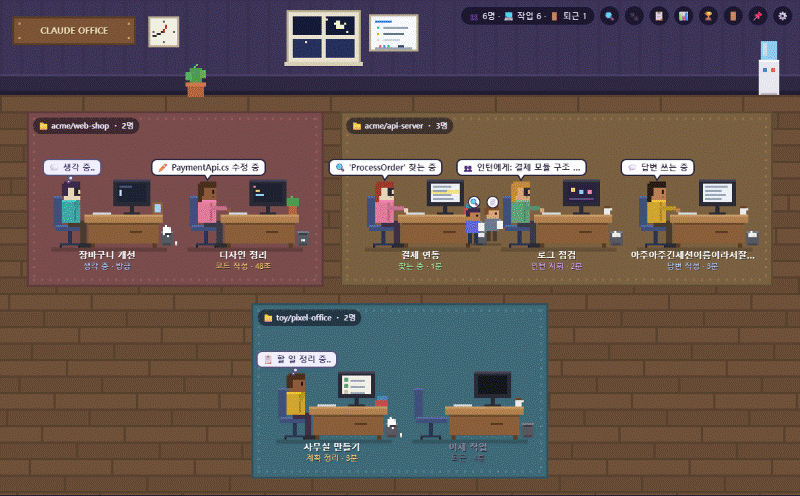
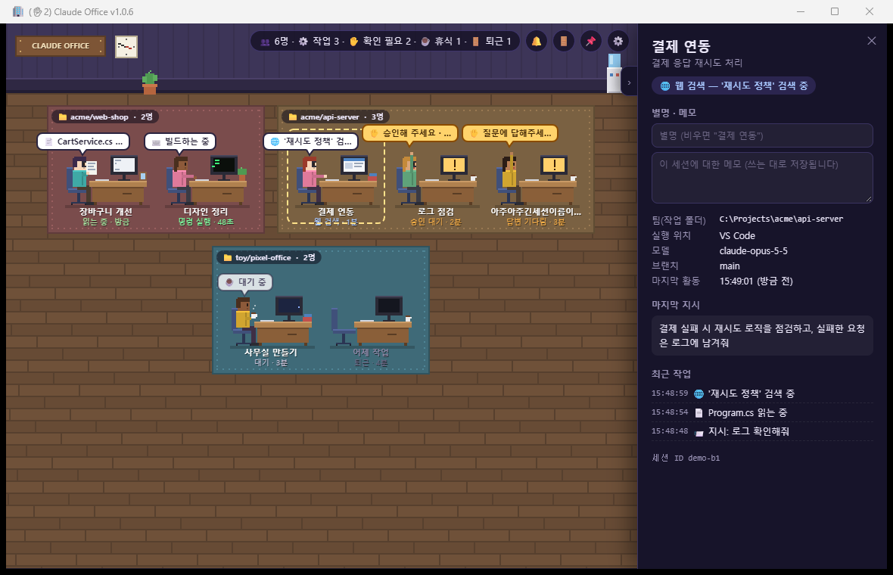
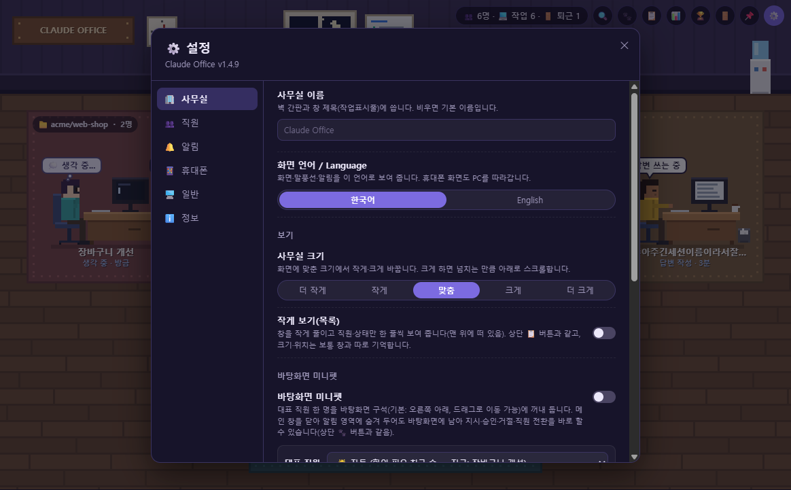
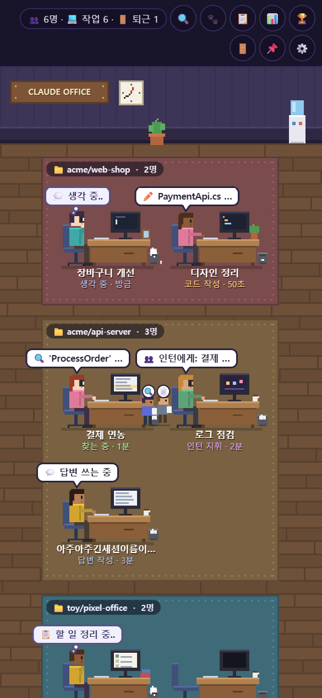
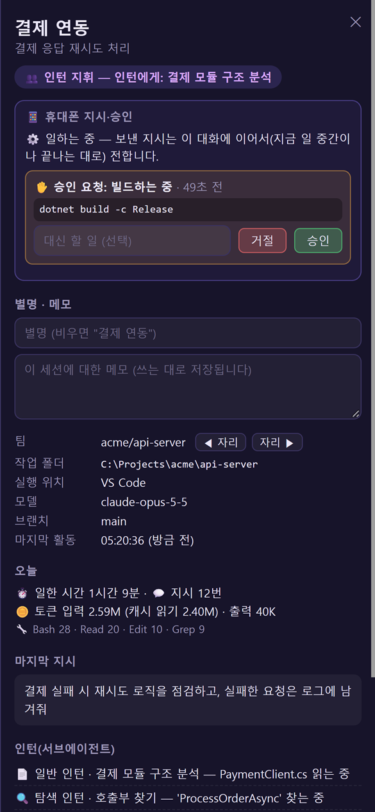

# 🏢 Claude Pixel Office

**한국어** · [English](README.en.md)

**Claude Code가 지금 무엇을 하는지, 나를 기다리고 있는지 — 작은 픽셀 사무실로 한눈에 보여 주는 Windows 프로그램입니다.**

Claude Code 대화(세션) 하나가 직원 한 명이 됩니다. 직원의 자세·모니터·머리 위 말풍선을 보면 지금 하는 일을 알 수 있고,
내 승인이나 답이 필요하면 직원이 손을 듭니다.
바탕화면에 띄워두는 **미니위젯(🪟 시메지 산책 & 다이내믹 아일랜드)**으로 다른 작업 중에도 한눈에 상태를 살피고, 자리를 비웠을 때는 **휴대폰(📱)으로 어디서든 승인하고 다음 일을 직접 지시**할 수도 있습니다.
직접 코인을 모아 가구를 배치하는 **오피스 상점(🛋️)**, 쉬는 시간 기지개와 커피를 즐기는 **자율 행동 AI(☕)**, 실시간 **낮/밤/야근 조명(🌙)**, **전체 세션 브로드캐스트 지시(📢)**, **에이전트 회의실 협업(🤝)**, **야간 당직 스케줄러 & 아침 브리핑(🌙)**, **화이트보드 3열 칸반(📋)**, **대화 기억량 게이지(🧠)**, 모바일에서 변경 코드를 미리 검토하는 **Git Diff 아코디언(🔍)**과 **음성 지시(🎙️)**까지 지원합니다.

> Anthropic과 관계없는 비공식 도구입니다. Claude Code가 남기는 대화 기록 파일을 읽기만 합니다.



설치 없이 브라우저로 먼저 구경하기: **https://jibong614.github.io/claude-pixel-office/?demo**

## 왜 쓰나요?

1. **Claude Code 창을 여러 개 띄워 두고 일할 때, 누가 뭘 하는지 한눈에**
   터미널 창을 하나씩 열어 보지 않아도 됩니다.
   예) "장바구니 개선"은 ✏️ 코드 작성 중, "디자인 정리"는 ⌨️ 빌드하는 중, "로그 점검"은 ✋ 내 승인을 기다리는 중
2. **🪟 바탕화면 미니위젯(MiniWidget) — 시메지 산책 모드 & 초슬림 다이내믹 아일랜드 & 개발자 명언**
   코드 편집기나 웹 브라우저를 전체화면으로 띄워 둬도, 투명한 작은 미니위젯이 바탕화면 구석을 지키며 말풍선으로 실시간 작업 현황을 알려줍니다.
   - 🚶 **시메지(Shimeji) 산책 모드**: 직원이 책상을 벗어나 화면 밑단을 아장아장 걷고, 방향을 전환하며 점프하는 귀여운 힐링 모드
   - 🏝️ **초슬림 다이내믹 아일랜드**: 38px 알약 캡슐 형태로 상단에 플로팅되어 시야를 가리지 않으며, 호버 시 `[⚡ 콘솔 점프]`, `[🛑 중단]`, `[승인]` 버튼 즉시 노출
   - 💡 **개발자 유머 명언 이스터에그**: 클릭 시 25종의 공감 200% 개발자 밈과 명언 말풍선 출력 ("내 컴퓨터에서는 잘 되는데요?", "버그가 아니라 문서화되지 않은 기능입니다" 등)
   - 미니위젯 위에서 바로 도구 사용을 승인하거나 다음 지시(텍스트 및 🎙️ 음성)를 건넬 수 있습니다.
3. **📱 자리를 비워도 멈추지 않는 개발 — 휴대폰에서 지시하고 비상정지까지**
   휴대폰에는 Claude 로그인이 필요 없습니다. QR을 한 번 찍어 두면 밖(LTE/5G)에서도 실시간 대화 흐름이 보입니다.
   - 🔍 **승인 전 Git Diff 사전 검토**: "파일을 수정해도 될까요?" 승인 요청 시, 수정될 코드 diff(`+N`, `-N`)를 모바일에서 펼쳐보고 안전하게 **[승인]**
   - 🎙️ **음성 프롬프트 지시 (Voice-to-Prompt)**: 이동 중이나 손이 바쁠 때 마이크를 누르고 말하면 실시간 텍스트로 자동 변환되어 전달
   - ❓ 질문이 생겼을 때 → 휴대폰에서 **객관식 선택지를 터치해 바로 답변**
   - 💬 일이 끝나면 휴대폰에서 **"이제 README도 정리해 줘"**를 보내면, 쉬던 세션이 깨어나 **같은 대화에서 이어서** 일합니다
   - 🛑 무한 루프나 이상 동작이 발생하면 → 모바일 터치 한 번으로 **[🛑 긴급 작업 중단]**
   - 🔎 작은 화면에서도 **두 손가락 핀치 줌(1.0x~3.5x)과 더블 탭**으로 원하는 직원을 시원하게 확대
4. **🛋️ 오피스 인테리어 & 가구 상점 — 일하며 모은 코인으로 꾸미는 픽셀 오피스**
   개발 작업을 완료하고 토큰을 절약할 때마다 🪙 코인이 차곡차곡 쌓입니다.
   에스프레소 머신, 고양이 '나비', 레트로 오락기 등 7종의 아기자기한 소품을 구매해 사무실을 꾸며보세요. 소품을 클릭하면 고유한 8비트 사운드와 함께 사랑스러운 리액션이 펼쳐집니다!
5. **☕ 살아 숨쉬는 자율 행동 AI & 24시간 실시간 조명**
   일이 끝난 직원은 정적으로 멈춰있지 않고, 두 팔을 번쩍 들어 기지개를 켜거나 따뜻한 커피를 마시며 개발자 공감 💭 랜덤 생각 말풍선을 띄웁니다.
   실제 시간에 따라 낮, 노을, 야간, 심야 야근 조명이 바뀌며, 밤샘 야근 중인 열일 직원에게는 집중 스포트라이트 조명이 비춥니다.
6. **📋 사무실 화이트보드 — 프로젝트 할 일(TODO) 실시간 조망**
   직원들이 대화하며 세운 계획과 할 일(TODO)이 창문 옆 화이트보드에 자동으로 정리됩니다. 프로젝트가 어디까지 진행되었는지 한눈에 파악하세요.
7. **🏆 도전 과제 도감 — 게임처럼 재미있게 익히는 30가지 마스터 퀘스트**
   회사 이름 짓기, 첫 가구 구매, 오피스 고양이 쓰다듬기, 심야 야근 코딩 등 **30가지 업적**이 준비되어 있습니다. 퀘스트를 깨며 레벨과 코인을 획득하다 보면 어느새 Claude Pixel Office의 모든 기능을 마스터하게 됩니다.
8. **나를 기다리는 순간을 놓치지 않게**
   승인·질문을 기다리면 직원이 손을 들고, 창 제목·작업표시줄에 `(✋2)`처럼 개수가 뜨고, Windows 알림이 옵니다.
9. **오늘 얼마나 일했는지 & 비용 절감**
   직원마다 일한 시간·지시 횟수·토큰 사용량·프롬프트 캐시로 아낀 비용을 보여 줍니다(📊 오늘의 근무 일지).

## 화면

| PC — 직원 상세 | PC — 설정 |
|---|---|
|  |  |

| 휴대폰 — 사무실 | 휴대폰 — 자리 비웠을 때 승인 |
|---|---|
|  |  |

## 할 수 있는 것

- 👥 **세션 = 직원, 작업 폴더 = 팀 구역(카펫), 서브에이전트 = 책상 옆 인턴**
- 💬 **하는 일을 그대로**: 읽기·코드 작성·명령 실행·검색·웹 검색·인턴 지휘·계획 정리·답변 작성. 말풍선은 되도록 한글로(예: `dotnet build` → "빌드하는 중")
- 🛋️ **오피스 인테리어 상점 & 코인 시스템**: 작업 완료(+5) 및 캐시 절약(+10)으로 🪙 코인을 모아 커피머신, 고양이 '나비', 오락기 등 7종 소품을 구매하고 배치. 클릭 시 8비트 효과음과 동작 연출
- ☕ **살아 숨쉬는 자율 행동 AI**: 대기 중 기지개 켜기(`\o/`, 눈웃음), 커피 마시기, 개발자 공감 💭 일상 생각 말풍선(점심 고민, 리팩토링, 고양이 등) 자율 표현
- 🌙 **24시간 실시간 조명 & 야근 스포트라이트**: 실제 시간에 맞춰 낮(06~18시) → 노을(18~20시) → 야간(20~24시) → 심야 야근(00~06시)으로 전환. 심야에는 일하는 책상 위로 스포트라이트 콘 조명 투사
- 🎵 **8비트 레트로 사운드 팩**: 순수 Web Audio 신디사이저 기반 코인, 구매 팡파르, 고양이 울음소리, 커피, 오락기, 비상정지 경보음 등 풍성한 레트로 사운드
- 🪟 **바탕화면 미니위젯**: 일반 창틀 모드, **바닥을 총총 걷는 🚶 시메지 산책 모드**, 상단 38px 캡슐 **🏝️ 초슬림 다이내믹 아일랜드 모드**, **💡 25종 개발자 밈/명언 이스터에그** 지원
- 📢 **전체 세션 브로드캐스트 지시 (`단축키 B`)**: 모든 활성 AI 세션에 `/compact`, 단위 테스트, Git 점검 등을 일괄 동시 전달
- 🤝 **회의실 테이블 & 멀티 에이전트 협업**: 2인 이상 세션 동시 구동 시 오피스 회의 테이블에서 백엔드/프론트엔드 연동 및 CI 통과 실시간 협업 대화 연출
- 🌙 **야간 당직(Night Shift) 모니터링 & 아침 브리핑 (`단축키 N`)**: 야간 무인 가동 시간, 완료 태스크, 코인/토큰 절감량 자동 집계 및 ☀️ 아침 업무 브리핑 Markdown 리포트 원클릭 복사
- 📊 **화이트보드 3열 칸반 & 🧠 컨텍스트 잔여량 게이지**: To Do / In Progress / Done 3열 카드 뷰와 토큰 포화 시 땀방울/얼음주머니 연출 및 `/compact` 원클릭 복사
- ⚡ **원클릭 콘솔 점프 (`Alt+1~9` / `J`)**: 책상 더블 클릭이나 단축키로 해당 세션의 VS Code, Cursor, Windsurf, Aider, 터미널 창으로 즉각 포커스 이동
- 🧪 **견고한 품질 검증**: xUnit 자동화 단위 테스트 프로젝트 구축 (36개 단위 테스트 전원 통과)
- 📱 **강력한 휴대폰 원격 제어**: **[켜기] → QR 한 번**. 자리 비움 시 원격 알림 + **🔍 승인 전 Git Diff 아코디언 확인** + 승인/거절 + **🎙️ 음성(Voice-to-Prompt) 및 텍스트 지시** + 객관식 질문 답변 + **실시간 긴급 중단(🛑)** + **🔎 핀치 줌(1.0x~3.5x) & 더블 탭 제스처**. 🔒 무료 서버를 거치지만 종단간 암호화(AES-256-GCM)로 서버도 남도 내용을 절대 볼 수 없음
- 📋 **화이트보드**: 세션 대화에서 추출한 실시간 할 일(TODO) 및 진행 상태 게시
- 🏆 **도전 과제 (퀘스트 도감)**: 30종 업적 달성, 경험치/레벨 시스템, 완료한 업적 숨기기 필터, 보너스 코인 지급
- 🛑 **안전한 이중 비상정지**: 실행 중인 명령 프로세스 즉시 강제 종료 + `PreToolUse` 훅 차단으로 0.01초 만에 안전하게 멈춤 (PC 유휴 시간 보존)
- 🔍 **직원을 누르면 상세**: 마지막 지시, 최근 작업, 인턴 목록, 오늘 통계, 내가 붙이는 **별명·메모**(세션 이름을 바꿔도 남음)
- 🔔 **PC 알림**: 기다리기 시작할 때·오래 걸린 일이 끝났을 때. 소리·방해 금지 시간대 설정
- ▤ **작게 보기(위젯)**: 직원·상태만 한 줄씩, 늘 맨 위에
- 🪟 **알림 영역 상주·자동 실행**: ✕를 눌러도 숨기만 하고, Windows 시작 때 저절로 켜 둘 수 있음. 새 버전은 앱 안에서 바로 업데이트
- 🔗 **Claude Code 연결(권장)**: 처음 켤 때 한 번 묻습니다 — 승인·질문 대기를 정확히 보여 주고 휴대폰 지시·승인도 이 연결로
- 🌐 화면 언어: 한국어·English
- 🔒 **안전성**: 대화 기록 파일만 읽고, Claude Code 설정은 확인 창에서 [예]를 눌렀을 때만 안전하게 훅 등록

## 빠른 시작

### 1. 내려받아 실행 (권장)

1. [Releases](https://github.com/jibong614/claude-pixel-office/releases)에서 `ClaudePixelOffice-v*-win-x64.zip` 을 내려받습니다(그다음부터 새 버전은 앱 안에서 바로 업데이트)
2. 압축을 풀고 `ClaudeOffice.exe` 를 실행합니다
3. 처음 켤 때 **"Claude Code와 연결할까요?"** → **[예]**(권장)
4. Claude Code로 대화를 시작하면 책상에 직원이 나타납니다
5. (선택) 휴대폰으로도 보려면 ⚙️ → 📱 휴대폰 → **[켜기] → [QR 보기]** → 휴대폰 카메라로 찍기

- 필요한 것: Windows 10/11, [Microsoft Edge WebView2 런타임](https://developer.microsoft.com/microsoft-edge/webview2/)(Windows 11에는 기본 포함). .NET은 따로 설치하지 않아도 됩니다
- 서명하지 않은 프로그램이라 처음 실행할 때 Windows SmartScreen 경고가 뜰 수 있습니다 → **추가 정보 → 실행**

### 2. 소스에서 빌드

[.NET 8 SDK](https://dotnet.microsoft.com/download/dotnet/8.0)가 필요합니다.

```powershell
git clone https://github.com/jibong614/claude-pixel-office.git
cd claude-pixel-office
dotnet build ClaudeOffice.sln -c Release
src\ClaudeOffice\bin\Release\net8.0-windows\ClaudeOffice.exe
```

### 견본 화면

Claude Code 기록 없이 모든 상태를 돌아가며 보려면:

```powershell
ClaudeOffice.exe --demo
```

설치 없이 브라우저로 보려면: **https://jibong614.github.io/claude-pixel-office/?demo** (이 공용 페이지가 휴대폰 화면이기도 합니다)

## 사용법

### 화면

| 무엇 | 하는 일 |
|---|---|
| 직원 클릭 | 오른쪽에 상세 패널. 같은 직원을 다시 누르면 접기·펼치기 |
| 패널 왼쪽 손잡이 `›` | 패널 접기(사무실이 창 전체를씀). 펼쳐져 있을 때는 사무실이 남은 폭에 맞춰 다시 배치돼 직원을 가리지 않음 |
| 🪙 코인 잔액 | 현재 보유 코인 표시. 클릭 시 🛋️ 오피스 상점 열기 |
| 🛋️ 상점 | 7종 인테리어 가구/소품 상점 열기 (소품 구매, 배치 및 보관) |
| 🪟 | **바탕화면 미니위젯** 켜기/끄기 — 작업 표시줄 위나 구석에 작고 투명하게 상주 |
| 📋 화이트보드 | 사무실 좌측 창문 옆 — 세션의 실시간 할 일(TODO) 목록 표시 |
| 🏆 | **도전 과제 도감** — 25종 퀘스트 현황, 레벨, 완료한 업적 숨기기 |
| 🛑 | **긴급 작업 중단** — 실행 중인 도구 프로세스를 즉시 종료하고 안전하게 대기 상태로 복귀 |
| ▤ | 작게 보기(위젯) — 창을 작게 줄이고 직원·상태 목록만, 늘 맨 위 |
| 📊 | 오늘의 근무 일지 — 일한 시간·지시·토큰·캐시 절감 비용 |
| 🔕 | Claude Code와 연결 안 됨 — 누르면 연결(다 연결되면 사라짐, 아래 "Claude Code 연결") |
| 🚪 | 퇴근한 직원 보이기/숨기기 |
| 📌 | 항상 위에 표시 |
| ⚙️ | 설정 |
| 알림 영역 🧑‍💻 | 누르면 창 열기, 오른쪽 클릭 → 끝내기 |

### 기록 → 사무실

| Claude Code 기록 | 사무실 |
|---|---|
| 세션 파일 | 직원(이름표 = `/rename` 세션 이름, 없으면 자동 요약 제목) |
| 작업 폴더(`cwd`) | 팀 구역 — 폴더 마지막 두 단계(예: `acme/web-shop`) |
| `<세션>\subagents\agent-*.jsonl` | 책상 옆 인턴 |
| 사람의 지시 | 💭 생각 중 |
| 도구 사용 Read / Grep·Glob / Edit·Write / Bash·PowerShell / WebSearch / Agent | 📄 읽기 / 🔍 찾기 / ✏️ 코드 작성 / ⌨️ 명령 실행 / 🌐 웹 검색 / 👥 인턴 지휘 |
| AskUserQuestion, ExitPlanMode | ✋ 답변 기다림(손 들기) |
| 응답 끝 | ☕ 대기 (기지개·커피 자율 행동, 💭 생각 말풍선) → 10분 뒤 💤 졸음 → 3시간 뒤 🚪 퇴근 |

### 설정 (⚙️)

가운데 팝업으로 뜨고 탭으로 나뉩니다(마지막에 본 탭을 기억, Esc·바깥을 누르면 닫힘). 맨 위에는 버전과 — 새 버전이 나왔으면 — **[업데이트]** 버튼.

| 탭 | 항목 |
|---|---|
| 🏢 사무실 | 사무실 이름(벽 간판·창 제목) / 화면 언어(한국어·English) / **보기**: 사무실 크기(더 작게~더 크게) · 작게 보기(목록) / **팀**: 팀(작업 폴더)마다 표시 이름·카펫 색·순서 — 직원 자리는 직원 상세의 ◀ ▶ |
| 🪟 미니위젯 | 미니위젯 켜기·끄기 / 항상 위에 표시 / 대표 직원 고정 또는 자동 선택 / 크기 및 투명도 조절 |
| 👥 직원 | 표시 기간(12시간·24시간·3일·7일) / 퇴근한 직원 보이기 / ✋ 기다리는 직원만 보기 / 보일 인원(1~30명) / 고르는 방식 — 최근 사용순 또는 직접 고르기(체크 목록) |
| 🔔 알림 | ✋ 기다릴 때 / 오래 걸린 일이 끝나면(5분·10분·30분·1시간) / 알림음 / 방해 금지 시간대 / 알림 시험 — 창을 보고 있을 때는 띄우지 않음 |
| 📱 휴대폰 | **휴대폰 연결**: 켜기 · QR(주소 복사 · 키 새로 만들기) / **자리를 비웠을 때**: 입력이 없으면 자리 비움(끔·1·3·5·10분) · 화면을 잠그면 자리 비움 / **고급**: 휴대폰에서 별명·메모 고치기 |
| 🖥️ 일반 | **창**: 항상 위에 표시 · 시작 시 알림 영역에 숨기기 · 닫기(✕)를 눌러도 숨기기 · Windows 시작할 때 자동 실행 (창 위치·크기는 저절로 기억) / **Claude Code 연결**: 연결하기 · 끊기 |
| ℹ️ 정보 | 버전·새 버전 확인·**[업데이트]**(앱 안에서 받아 바로 바꿈) / 새 버전 알림 / **백업·초기화**: 별명·메모 내보내기·가져오기 · 설정 초기화 / **문제 해결**: 문제 보고(GitHub 이슈) · 데이터 폴더 열기 |

휴대폰 화면의 설정에는 휴대폰에서 바꿀 수 있는 것만(🏢 사무실의 보기, 👥 직원) 나옵니다.

### 명령줄

| 옵션 | 뜻 |
|---|---|
| `--demo` | 견본 화면 |
| `--exit` | 켜져 있는 Claude Pixel Office를 정상 종료 |
| `--autostart` | 자동 실행용 — 알림 영역에 숨긴 채 시작 |
| `--offscreen` | 점검 도구용 — 창을 화면 밖에 포커스 없이 띄움 |

이미 켜져 있을 때 다시 실행하면 새로 켜지지 않고 그 창이 열립니다.

## Claude Code 연결 (권장)

대화 기록에는 "승인 창이 떠 있다"가 남지 않아서, 연결하지 않으면 파일 수정이 오래 끝나지 않을 때 승인 대기로 **짐작**만 합니다.
처음 켤 때 **"Claude Code와 연결할까요?"**에 [예]를 누르거나, 나중에 ⚙️ → 🖥️ 일반 → **Claude Code 연결**(또는 상단 🔕)을 누르면
확인 창을 거쳐 Claude Code 설정(`~/.claude/settings.json`)에 몇 줄(훅)을 넣고, 그때부터 정확히 표시합니다. 휴대폰 지시·승인·비상정지도 이 연결로 받습니다.

| 넣는 것(훅) | 하는 일 |
|---|---|
| `PermissionRequest` | ✋ 승인해 주세요 · 무엇을 하려는지 — 그 도구 호출이 끝나면(승인 후 완료·거절·중단) 내림. 자리 비움이면 승인 창 대신 휴대폰의 승인·거절을 기다림(최대 55분, 넘으면 평소 승인 창) |
| `Notification` | 승인·입력 요청 알림 |
| `SessionEnd` | 세션을 닫으면 바로 🚪 퇴근 |
| `Stop` · `SessionStart` | 답을 마친(또는 막 연) 세션이 뒤에서 기다리다가 휴대폰 지시가 오면 그 세션을 깨워 전함(`asyncRewake`, 최대 하루). 프로그램을 껐다 켜도(업데이트 등) 15초 안에 다시 붙음 — 세션마다 하나만 |
| `PreToolUse` | 🛑 도구 실행 전 긴급 중단 플래그 검사 — 비상정지 요청 시 종료 코드 2로 도구 실행을 즉시 차단하고 안전하게 대기 상태로 복귀 |

- 넣는 줄은 `curl … http://127.0.0.1:47821/…; exit 0` 꼴입니다(Git Bash로 실행, 없는 PC에서는 같은 일을 하는 PowerShell 명령). 이 PC 안에서 이 프로그램과만 주고받고,
  프로그램이 꺼져 있으면 **아무 일 없이 성공으로 끝나** 대화창에 오류가 남지 않습니다(휴대폰 지시를 기다리는 훅만 프로그램이 켜질 때까지 뒤에서 조용히 기다림)
- 끊으면 이 프로그램이 넣은 줄만 뺍니다. 고치기 직전 원본은 `settings.json.claudeoffice.bak` 으로 남습니다
- 승인한 순간을 알려 주는 훅은 없어서, 명령 실행(Bash·PowerShell) 승인 대기 중에 **그 명령의 프로세스가 새로 생기면** 승인된 것으로 보고 손을 내립니다(승인 후 오래 도는 빌드도 "실행 중"으로). 명령을 인코딩해 넘기는 경우 등 알아보지 못하면 끝날 때 내립니다

## 휴대폰 연결 (선택)

⚙️ → 📱 휴대폰 → **휴대폰 연결 [켜기]** → **[QR 보기]** → 휴대폰 카메라로 찍으면 끝입니다. 설정·로그인·계정 만들기가 없고, 밖에서도 됩니다(홈 화면에 앱으로 설치 가능).

- 🔒 **무료 서버**를 거칩니다 — 휴대폰 화면은 이 저장소의 공용 페이지(GitHub Pages), 전달은 Google Firebase(무료).
  PC가 **화면용 요약만**(대화 원본은 아님) gzip → AES-256-GCM으로 잠가서 보내고, 휴대폰이 **기기 안에서** 엽니다.
  열쇠는 QR 주소의 `#` 뒤에만 있어 서버로 가지 않으므로 **서버도, 함께 쓰는 다른 사용자도 내용을 볼 수 없습니다.** 각 PC는 자기 칸에만 쓸 수 있습니다
- PC 프로그램을 끄면 휴대폰에 `💤 PC에서 꺼짐`이 바로 뜨고 사무실이 흐려집니다
- 휴대폰에서 별명·메모도 고칠 수 있습니다(⚙️ → 📱 휴대폰 → 고급에서 끌 수 있음)
- 무료 한도 안에서 운영합니다 — 쓰는 사람이 아주 많아 한도를 넘으면 잠시 멈출 수 있지만 요금은 나오지 않습니다

자세히(예전 버전에서 옮겨 올 때 포함): **[docs/MOBILE.md](docs/MOBILE.md)**

### 자리를 비웠을 때 — 휴대폰에서 지시·승인

Claude Code와 연결해 두면, 자리를 비운 동안 휴대폰에서 직원(세션)에게 **새 지시를 보내고**, **승인 요청에 승인·거절로 답하며**, **돌발 상황 시 긴급 중단**할 수 있습니다.
휴대폰에는 Claude 로그인이 필요 없습니다 — 일은 PC의 Claude Code가 자기 로그인으로 합니다.

1. **그냥 자리를 뜨고 휴대폰으로 사무실을 엽니다.** PC에서도 휴대폰에서도 누를 버튼은 없습니다
   - PC를 30초 넘게 안 쓰는 동안 휴대폰 화면이 열려 있으면 그때부터 지시·승인이 휴대폰으로 옵니다(= 자리 비움). 돌아와 마우스·키보드를 움직이면 PC로 돌아갑니다
   - 휴대폰을 안 보고 있어도 입력이 **3분**(설정에서 끔·1·5·10분) 없거나 **화면을 잠그면**(⊞+L, 바로) 자리 비움 — 그 사이 온 승인 요청은 휴대폰을 열 때까지 기다립니다
2. 휴대폰에서 직원을 누르면 **📱 휴대폰 지시·승인** 칸이 보입니다
   - 🔍 **승인 전 Git Diff 사전 검토 (핵심!)**: 파일 수정 도구(`Edit`, `Write` 등)가 승인을 요청하면 모바일 화면에 접이식 아코디언(`+N`, `-N`)으로 변경될 코드 diff가 나타납니다. 수정 내용을 꼼꼼히 확인하고 안심하고 [승인]할 수 있습니다.
   - 🎙️ **음성 프롬프트 지시 (Voice-to-Prompt)**: 입력창 옆 🎙️ 마이크 버튼을 누르고 말하면 실시간으로 텍스트로 자동 변환되어 Claude에게 즉시 전송됩니다. 이동 중이거나 손이 바쁠 때 유용합니다.
   - 💬 **새 지시 보내기**: 텍스트를 입력하고 [보내기]를 누르면, 쉬고 있던 세션이 즉시 깨어나 **같은 대화 맥락에서 이어서 일합니다.** (예: "README도 정리해줘", "방금 만든 함수 단위 테스트 추가해줘") 만약 직원이 일하는 중이라면 지금 하던 일을 마치자마자 이어서 수행합니다.
   - ✋ **승인·거절**: 실행하려는 명령 원문과 Git Diff를 확인하고 [승인] / [거절]. 거절할 때 "대신 할 일"을 적으면 Claude가 그 지시를 따릅니다.
   - ❓ **객관식 질문 답변**: 세션이 질문(`AskUserQuestion`)을 던지면 모바일 화면에 선택지가 나타납니다. 원하는 선택지를 터치하면 즉시 답변이 전달됩니다.
   - 🛑 **긴급 작업 중단 (비상정지)**: 위험한 명령이 돌거나 무한 루프가 발생했을 때 누르면, PC의 해당 명령 프로세스를 즉시 강제 종료하고 Claude에게 중단 신호를 보냅니다.
   - 🔎 **모바일 캔버스 터치 제스처**: 작은 모바일 화면에서도 두 손가락 핀치 줌(1.0x~3.5x)으로 확대하고, 한 손가락으로 드래그해 이동하며, 직원을 더블 탭해 집중 줌인할 수 있습니다.
   - 🗨️ **마지막 답**: Claude가 마지막으로 남긴 답변도 모바일에서 바로 확인할 수 있습니다.

- **안전**
  - **누가 PC를 쓰고 있으면**(마지막 입력이 30초 안) 휴대폰은 자리 비움을 켤 수 없습니다 — 그때 보낸 지시는 버리고, 승인은 PC 승인 창으로 갑니다
  - 휴대폰이 보내는 것은 같은 열쇠로 잠가(AES-256-GCM) QR을 찍은 기기만 보낼 수 있고, 10분 넘은 것·이미 받은 것은 버립니다
  - 지시를 보내도 Claude의 권한 규칙은 그대로입니다 — 승인이 필요한 일은 여전히 승인 요청(→ 휴대폰)
  - 받은 지시·승인·거절·비상정지는 모두 데이터 폴더의 `remote.log` 에 남습니다
  - **QR·주소가 곧 열쇠입니다.** 남이 봤다면 ⚙️ → 📱 휴대폰 → **키 새로 만들기**
- 연결한 뒤 **새로 열거나 다시 연 세션은 바로**, 이미 열려 있던 세션은 **한 번 더 답을 마친 뒤부터** 지시를 받습니다. 업데이트 등으로 Claude Office를 껐다 켜도 쉬던 세션은 15초 안에 저절로 다시 붙습니다
- 휴대폰에 보이는 Claude의 마지막 답도 잠근 요약에 함께 실립니다(Claude Code와 연결했을 때만)

## 어떻게 동작하나

Claude Code는 세션마다 대화를 `%USERPROFILE%\.claude\projects\<프로젝트>\<세션ID>.jsonl` 에 한 줄씩 덧붙여 씁니다(`CLAUDE_CONFIG_DIR` 을 쓰면 그 아래).
이 프로그램은 그 폴더를 0.7초마다 훑어 **늘어난 부분만** 읽고(처음 보는 큰 파일은 끝 2MB만), 사무실 화면은 HTML 캔버스에 **그림 파일 없이 코드로** 그립니다.

```
src/ClaudeOffice/
  Monitoring/   기록 폴더 감시(TranscriptWatcher), 한 줄 해석(TranscriptParser), 도구 → 행동·말풍선(ToolCatalog),
                훅 반영(HookApplier), 시간 경과 반영 → 화면용 JSON(SnapshotBuilder), 도구 프로세스 관리(ApprovalProbe)
  Hooks/        Claude Code 연결 — 127.0.0.1 훅 수신기(HookServer), settings.json 훅 넣기/빼기(HookSetup)
  Cloud/        휴대폰 연결 — 요약 암호화·무료 서버(Firebase) 업로드, 익명 로그인(CloudSync, CloudConfig)
  Remote/       휴대폰 지시·승인·중단을 훅으로 세션에 전함, 자리 비움(RemoteHub)
  PetWindow     바탕화면 미니위젯 — 투명 윈도우, 항상 위, 상호작용
  MainWindow    WebView2 호스트, TrayIcon 알림 영역 아이콘, AutoStart 시작 프로그램 등록
  wwwroot/      사무실 화면(office.js 캔버스 픽셀아트) — PC 앱과 휴대폰 페이지가 같은 파일
mobile/         무료 서버 데이터베이스 규칙
tools/          점검 도구(아래)
```

### 데이터와 네트워크

- **읽기만**: Claude Code 대화 기록. 대화 내용은 어디로도 보내지 않습니다(휴대폰 연결을 켰을 때의 잠근 요약만 예외)
- **저장**: `%LOCALAPPDATA%\ClaudeOffice` — 화면 설정(WebView2 저장소), 별명·메모 사본 `share.json`, `app.json`, 휴대폰 연결 열쇠(`cloud.json`), Claude Code 알림 기록, 휴대폰 지시 기록 `remote.log`
- **네트워크**: Claude Code 연결은 `127.0.0.1` 만(브라우저가 보낸 요청은 받지 않음). 휴대폰 연결을 켰을 때만 잠근 요약을 무료 서버(Google Firebase)로 보냅니다(Claude Code와 연결돼 있으면 Claude의 마지막 답도).
  새 버전 확인은 하루 두 번(그리고 설정을 열 때, 10분에 한 번까지) GitHub API(`api.github.com`)에 최신 릴리스를 묻습니다(보내는 것은 프로그램 버전뿐, ⚙️ → 정보에서 끌 수 있음)

## FAQ

**직원이 안 보여요.**
마지막 대화가 표시 기간(기본 12시간)보다 오래된 세션은 띄우지 않습니다. ⚙️ → 👥 직원 → 표시 기간을 늘리세요. 판단 기준은 파일 수정 시각이 아니라 **대화 시각**입니다.

**✕를 눌렀는데 꺼지지 않아요.**
알림 영역(🧑‍💻)으로 숨은 것입니다. 끝내려면 아이콘 오른쪽 클릭 → 끝내기. ⚙️ → 🖥️ 일반에서 바꿀 수 있습니다.

**승인 대기가 늦게 뜨거나 안 떠요.**
Claude Code와 연결하세요(⚙️ → 🖥️ 일반, 또는 상단 🔕). 연결 전에는 파일 수정만 짐작하고 명령 실행 중의 승인 대기는 구분하지 못합니다.

**다른 PC나 WSL에서 쓰는 Claude Code도 보이나요?**
아니요. 프로그램이 실행된 Windows 사용자의 기록 폴더만 읽습니다. 그 PC에서 실행하세요.

**Claude Code 설정을 바꾸나요?**
묻지 않고는 바꾸지 않습니다. 처음 켤 때의 질문이나 **Claude Code 연결** 버튼에서 확인했을 때만 `settings.json` 에 몇 줄(훅)을 넣고, 끊으면 그것만 뺍니다.
이미 연결해 둔 뒤 새 버전이 그 줄의 명령을 고쳐야 할 때만 묻지 않고 그 줄만 새 것으로 바꿉니다(바꾸기 직전 원본은 `settings.json.claudeoffice.bak`).

**휴대폰에서 보낸 지시가 안 가요.**
PC를 누가 쓰고 있으면(마지막 입력이 30초 안) 받지 않습니다 — 자리를 뜨고 잠시 뒤 보내세요. 직원 상세에 "📡 연결됨"이 보여야 바로 전해집니다 —
Claude Code와 연결하기 전부터 열려 있던 세션은 한 번 더 답을 마쳐야 연결됩니다. 받은 것·전한 것은 데이터 폴더의 `remote.log` 에서 확인할 수 있습니다.

**무료 서버라는데, 남이 내 사무실을 볼 수 있나요?**
아니요. 서버에는 내 PC와 내 휴대폰만 가진 열쇠로 잠근 상자만 지나갑니다. 열쇠는 QR 주소의 `#` 뒤에만 있어 서버로도 가지 않습니다. QR을 남에게 보이지만 마세요(보였다면 키 새로 만들기).

## 개발

- 빌드: `dotnet build ClaudeOffice.sln` (Debug 빌드는 소스의 `wwwroot` 를 직접 읽어 화면은 창에서 **F5**만 누르면 반영)
- 점검 도구(`tools/`) — 시험 창은 화면 밖에 띄워 작업을 방해하지 않습니다
  - `capture.ps1` 창 캡처 / `pagetest.ps1` 화면 안에서 JS 단계 실행·캡처(`-Mobile` 휴대폰 크기)
  - `watchtest` 화면 없이 기록 해석 결과 출력(`--phrases` 말풍선 점검, `--hooks` 훅 수신)
  - `fake-rtdb.py` 가짜 무료 서버(휴대폰 연결 시험 — 화면에서 `send({cmd:'cloud-setup', text:'{ databaseURL: "http://127.0.0.1:8765" }'})`) / `deploy-rules.ps1` 무료 서버 데이터베이스 규칙 올리기(관리자)
  - `make-icon.ps1`·`make-app-icons.ps1` 아이콘 만들기 / `make-gif.ps1` 캡처 여러 장 → 동작 GIF
- 릴리스: `v1.2.3` 태그를 올리면 `.github/workflows/release.yml` 이 자체 포함 exe 를 빌드해 릴리스 zip 으로 붙입니다. 휴대폰 공용 페이지는 `pages.yml`
- Claude Code로 작업할 때의 규칙: [CLAUDE.md](CLAUDE.md) · 바뀐 내용: [docs/CHANGELOG.md](docs/CHANGELOG.md)

## 라이선스 · 출처

- [MIT License](LICENSE)
- 아이콘: 사무실 화면의 픽셀아트 직원(이 프로젝트가 코드로 그린 그림, `src/ClaudeOffice/Assets/office_pixel.png`) — 위 MIT License
- QR 코드: [qrcode-generator](https://github.com/kazuhikoarase/qrcode-generator) 1.4.4 — MIT License, © Kazuhiko Arase (`wwwroot/vendor/qrcode.js`)
- 화면 호스트: [Microsoft Edge WebView2](https://developer.microsoft.com/microsoft-edge/webview2/)
- "Claude"는 Anthropic의 상표이며, 이 프로젝트는 Anthropic과 관계가 없습니다

